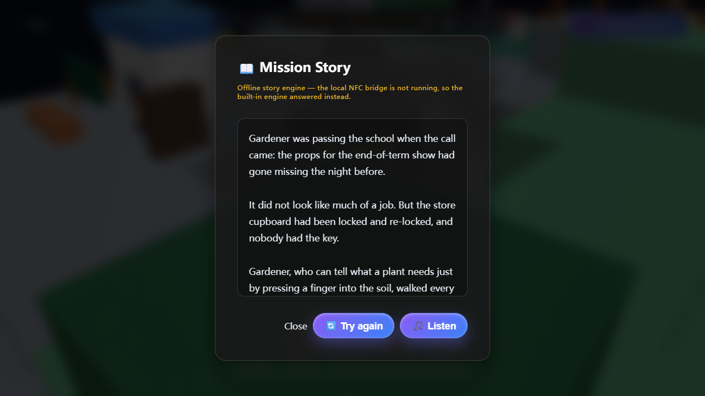

# Storypad — Whimsy Island

An interactive story board. You drop a hero onto a place, ask for the mission, and the
island tells you a story about what happened there.



---

## The idea

Storypad started as part of my graduation project on **NFC interactive storytelling for
children**. The physical version is a printed board with five NFC tokens and an Arduino
reader; you tap a token onto a spot on the board and the story responds.

For this assignment I took that same interaction and rebuilt the part that matters — the
loop between *placing a character*, *the programme responding*, and *the feedback you get
back* — as a single web page that anyone can open. The board is now a 3D island with four
places on it. Everything the hardware did in the original (placing, recalling, moving
between places) is done with the mouse or a finger here, and the NFC hardware path has
been removed entirely, so the interaction can be tested with nothing but a browser.

## Who it is for

Children around 5–8, reading together with an adult. The story is short, spoken aloud if
you want it, and there is no text to type and no way to fail. A second audience is anyone
marking or reading this repository — see *Two ways it answers* below.

## The main interaction

The loop is one cycle, and every cycle is the same shape:

| You do | The programme does | You see / hear |
|---|---|---|
| Press **Start the mission** | The camera drops from the home view onto the board | The island stops spinning, the five heroes appear in a dock |
| **Drag a hero** onto one of the four places | Raycasts the drop point, plants a voxel figure there, plays a drop sound | The figure pops in, the camera flies to an overview of that place and then pushes in close on the hero |
| Drop a **second hero** somewhere else | Same again | Each hero keeps its own label over its head |
| Press **⚡ Accept the mission** | Reads which heroes are placed and where, then builds a story from exactly that cast | A story appears, with a line saying where it came from |
| Press **🎵 Listen** | Reads the story aloud | Audio plays from the speakers |
| Press **🎨 Draw illustration** | *(AI mode only)* Sends the cast to an image model | A picture appears under the story |
| Tap a placed hero, or press **↺ Clear all** | Removes the figure, frees the dock slot | The hero returns to the dock, ready to be placed again |

Placing a *different* hero in a *different* place genuinely changes the story — the
problem comes from the place, the method comes from the hero, and any extra heroes join in
at the climax. Gardener at Oasis Park and Explorer at Quiet Street are different stories,
not the same story with the names swapped.

## Two ways it answers

The board always completes the loop. What changes is *which engine writes the story*:

- **AI mode** — the story is written on the spot by the course AI service
  (`gpt-6-luna` through the shared course gateway), customised to the exact cast you
  placed. The keys ship with the page, so AI mode is the default; if the service is
  unreachable the badge flips to demo mode by itself.
- **Demo mode** — without either of those, the built-in offline story engine answers. It
  is a real generator, not a canned paragraph: it pulls the problem from the zone you
  dropped on and the method from the hero you dropped, then assembles a five-beat story
  with any other heroes joining in at the climax.

The badge at the top of the screen tells you which one you are in, and the line under the
story heading says where that particular story came from. **You do not need an API key, a
server, or an internet connection to try the interaction** — press Start, drag a hero,
press Accept the mission, and a story comes back.

## How to run it

The page loads Three.js from a CDN, so it needs a one-time internet connection. Serve it
over HTTP rather than opening the file directly — browsers block some local file access,
and it keeps the asset paths working.

```bash
# from the project folder
python -m http.server 8000
```

Then open <http://localhost:8000>. Any static server works:

```bash
npx serve .
# or
php -S localhost:8000
```

**Dependencies.** There is no build step and no `package.json`. The only external
dependency is Three.js r128, loaded from `cdnjs.cloudflare.com` in the `<head>`. If that
CDN is blocked, the 3D board will not appear and the page shows a plain error message
instead of a blank screen.

**Optional: AI mode.** Nothing to set up — the shared course keys are already filled in
and the page probes the service on load. If a key is ever rotated, paste the new one into
**⚙️ Settings**; it is kept in `localStorage` in your own browser and is never sent
anywhere except to the course endpoints. Clearing both fields restores the defaults.

**Background music.** `bgm.mp3` is already in the repository — it is AI-generated, so no
third-party track is involved — and it plays on the first interaction, with 🔊 toggling it. To use different music, replace the file with any mp3 of the
same name. If the file is ever missing, pressing 🔊 tells you plainly that it is gone and
the sound effects still work.

## What I added for this assignment

The board and the 3D island existed before this assignment. What I added here:

- **The offline story engine**, so the interaction completes with no server and no key.
- **Service detection and the mode badge**, so the player always knows which engine is
  answering instead of staring at a failed request.
- **Graceful failure**: every AI failure falls back to a story rather than an error, and
  shows a 🔄 Try again button.
- **↺ Clear all**, a single reset after watching someone hunt for the individual recall
  targets during a trial.
- **Missing-file handling** for `bgm.mp3`, so removing the music never breaks the page.
- **Narration** through the browser's own speech synthesis, so 🎵 Listen works with no
  setup at all, plus a voice picker and a speed slider so the reading can be made to sound
  like a storyteller rather than a robot.
- The whole interface translated into English.
- The NFC hardware path removed, and the AI calls moved from a local proxy to the
  course-provided AI endpoints, so everything runs from a static page.

See [PROCESS.md](PROCESS.md) for the design decisions and the user trial behind these.

## Known limitations

- **The illustration button needs the course AI service.** There is no offline picture
  generator, so if the service is unreachable 🎨 Draw illustration explains what is
  missing rather than drawing something. The story itself is unaffected.
- **Narration uses the browser's built-in voice.** The course media API also offers a
  Suno voice, but from a static page the browser is not allowed to call it (the endpoint
  sends no CORS headers and the shared story key is not opened for the audio models), so
  the page reads stories with `speechSynthesis` instead. The Suno path is implemented in
  the code and degrades silently; if the course ever opens that model up, the AI voice
  starts working with no code change. (I checked both ways: the gateway has no audio route
  at all — `/v1/audio/generations` returns 404 and `/v1/audio/speech` answers 403
  `key_model_access_denied` on the shared key.)
- **Narration quality depends on the browser.** Because the reading is done by the browser,
  so is the voice. Storypad now picks the best voice the device actually has instead of
  leaving the browser default (neural voices score highest, online ones next), and
  **⚙️ Settings** lets you pick any installed voice and set the speed — the choice is
  remembered per browser. In Microsoft Edge the list includes the `Online (Natural)`
  voices, which are markedly smoother than the built-in desktop ones.
- **Demo mode has a fixed vocabulary.** It draws on 4 places × 5 heroes plus the
  combinations between them, so it will repeat if you try the same pair twice. AI mode
  does not have this limit.
- **Browser speech voices vary.** Demo-mode narration uses whatever voices the operating
  system provides, so it can sound flat on some machines.
- **No persistence.** Reloading the page clears the board. The API key is remembered; the
  story is not.
- **Touch is supported but tuned for desktop.** Dragging works on a touchscreen, and the
  dock is sized for a mouse.

## Files

```
index.html            the whole experience (markup, styles, Three.js scene, story engine)
assets/               the five hero portraits
_tools/               one-off scripts used during development, kept for the record
README.md             this file
PROCESS.md            starting idea, design changes, user trial, AI use
CREDITS.md            borrowed code, data and media
```

## Credits

See [CREDITS.md](CREDITS.md). Summary: Three.js (MIT) for the 3D board; the hero
portraits and the mission illustrations are AI-generated; the story text is generated by
the course AI service in AI mode and by the built-in engine in demo mode.
